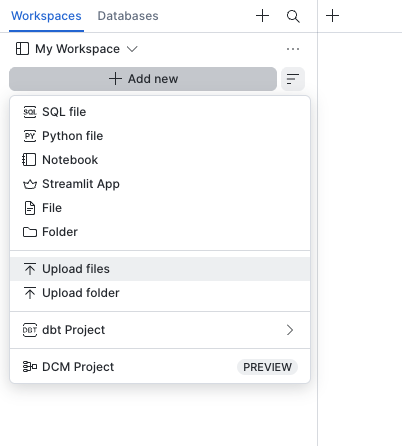
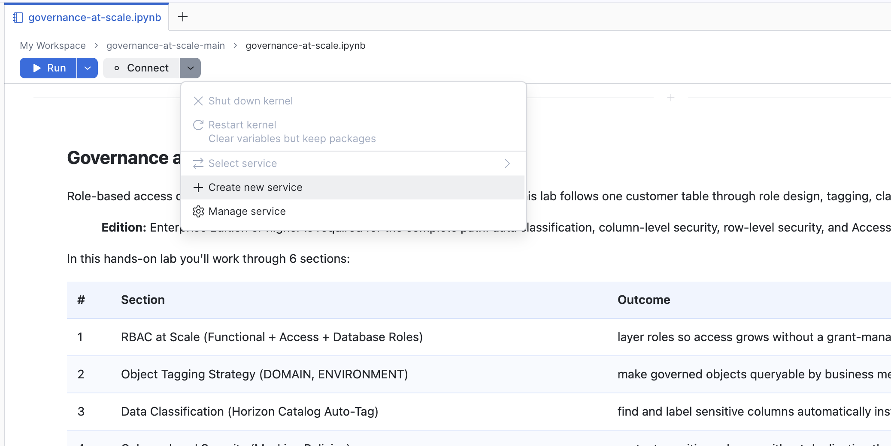
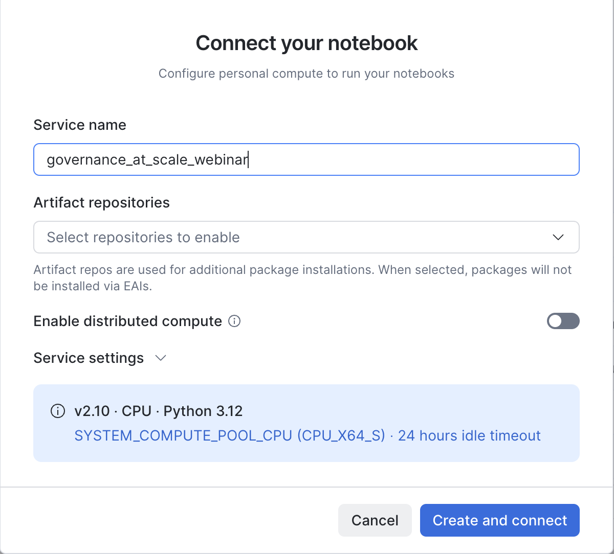
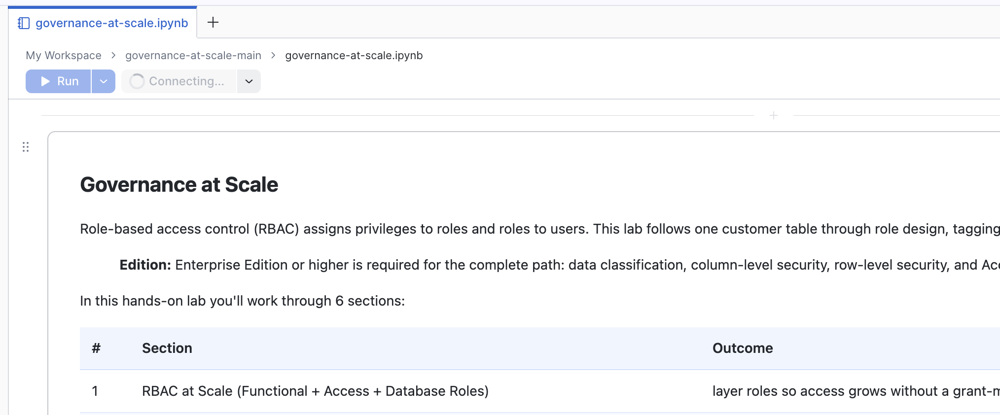
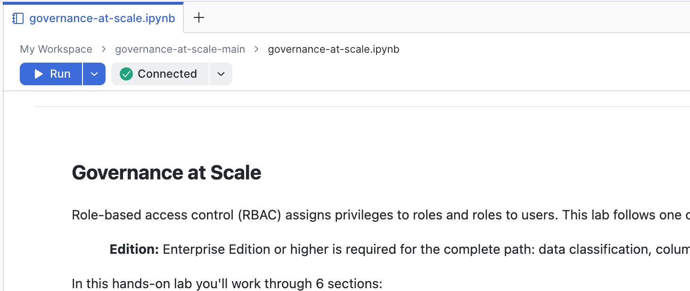
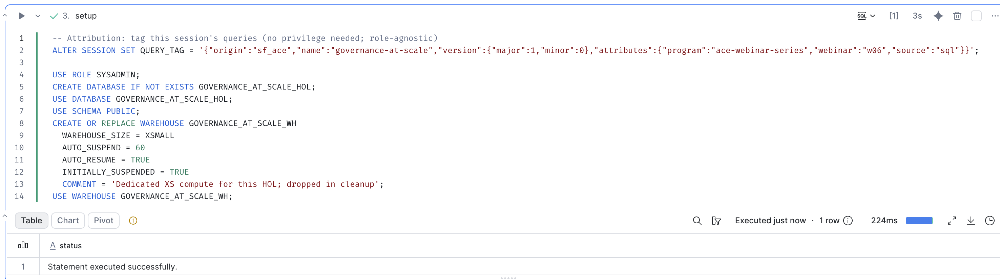

# Governance at Scale

A hands-on lab following one synthetic customer table through role design, tagging, classification, column- and row-level security, and audit evidence.

## Format

Self-paced companion to the Governance at Scale webinar. Work through the notebook sections in order in an isolated, non-production account.

**Validation status:** This release candidate has not passed an uninterrupted, end-to-end notebook run. Direct comparison-role execution, current-run policy audit evidence, and intentional cleanup remain unverified. Do not treat it as a production deployment template.

## Sections

1. Role-based access control (RBAC): functional, access, and database roles.
2. Object tagging: domain and environment labels.
3. Sensitive data classification.
4. Column-level security: masking policies.
5. Row-level security: row access policies.
6. Access History: column access and policy references.

## Prerequisites

- An isolated trial, sandbox, or development account. Use only the synthetic data provided in the notebook.
- Enterprise Edition or higher for the complete lab. The [Access History reference](https://docs.snowflake.com/en/sql-reference/account-usage/access_history) states: "Access History requires Enterprise Edition (or higher)."
- An administrator-approved lab user able to execute the notebook's role switches and object creation statements. The notebook switches among `SYSADMIN`, `USERADMIN`, `SECURITYADMIN`, `HOL_ACCESS_ROLE`, and `PUBLIC`; selecting a starting role is not a substitute for checking access.
- A supported compute pool for a notebook service. The [compute setup documentation](https://docs.snowflake.com/en/user-guide/ui-snowsight/notebooks-in-workspaces/notebooks-in-workspaces-compute-setup) states: "A user's role must have the USAGE privilege on a compute pool to create a notebook service and run notebooks." It continues: "In addition, the compute pool must allow the NOTEBOOK workload type through the ALLOWED_SPCS_WORKLOAD_TYPES parameter." Ask your administrator which pool to use.
- Approval to create the lab's warehouse, `GOVERNANCE_AT_SCALE_WH`. The setup cell specifies `WAREHOUSE_SIZE = XSMALL`.

## How to Run This Notebook

Download, upload, connect, then run one cell at a time.

### 1. Download the notebook

Open [`governance-at-scale.ipynb`](governance-at-scale.ipynb) and click **Download raw file**. No separate dataset is needed.

### 2. Open Workspaces

In Snowsight, go to **Projects > Workspaces**.

### 3. Select your workspace

Choose a workspace from the top-left dropdown. The screenshots use **My Workspace**.

### 4. Upload the notebook

Click **+ Add New > Upload Files**, select `governance-at-scale.ipynb`, then open it from the file list. See [upload instructions](https://docs.snowflake.com/en/user-guide/ui-snowsight/workspaces-working) if your interface differs.

*Upload screenshot from the companion lab; your interface may differ.*

### 5. Connect notebook compute

Open the **Connect** dropdown and click **+ Create new service**, or use **Select service** for an existing administrator-approved service.

Set **Service name** to `governance_at_scale_webinar`. Under **Service settings**, choose your administrator-approved compute pool and review the runtime and idle timeout. Click **Create and connect**.

*The pictured settings are examples, not required defaults. See [compute setup](https://docs.snowflake.com/en/user-guide/ui-snowsight/notebooks-in-workspaces/notebooks-in-workspaces-compute-setup) for details.*

Wait while the toolbar shows **Connecting...**.

Continue when **Connected** appears with a green check. Resolve any connection errors with your administrator first.

### 6. Review and run the lab

Before running, review the role switches, grants, and cleanup with your administrator. Reserve these names for the lab:

- Database: `GOVERNANCE_AT_SCALE_HOL`
- Warehouse: `GOVERNANCE_AT_SCALE_WH`
- Account roles: `HOL_ACCESS_ROLE`, `HOL_FUNCTIONAL_ROLE`
- Database role: `GOVERNANCE_AT_SCALE_HOL.HOL_DB_ROLE`

The notebook contains `CREATE OR REPLACE` statements: do not point it at names belonging to an existing workload. Do not assume arbitrary cell reruns are safe.

Use the [role and warehouse picker](https://docs.snowflake.com/en/user-guide/ui-snowsight/notebooks-in-workspaces/notebooks-in-workspaces-edit-run) as needed. The setup cell selects `GOVERNANCE_AT_SCALE_WH`.

The masking comparison deliberately contains grants to `PUBLIC` on the lab database, schema, table, and warehouse. This is a lab-specific comparison, not a recommended production grant design.

1. Run **`setup`** first using the triangular **Run cell** button.
2. Read and run the six sections in order, one cell at a time.
3. Check each result. Stop and resolve errors before continuing.
4. Leave **cleanup** commented out until you finish.

The screenshot shows a successful setup result, not end-to-end lab validation.

### 7. Allow for audit latency

The notebook retains presenter comments such as "PRE-STAGE BEFORE RECORDING." For a self-paced run, execute those cells at their position in the sequence; no recording preparation is required.

The [Access History reference](https://docs.snowflake.com/en/sql-reference/account-usage/access_history) states: "Latency for the view may be up to 180 minutes (3 hours)." Wait and rerun the audit queries if needed. Compare the returned query identifiers and timestamps with your own run; older rows bearing the same lab object names are not proof of the current run's outcome.

### 8. Clean up intentionally

The final cleanup code cell is disabled inside a `/* ... */` block comment. After reviewing its object names, remove those comment delimiters only when you intend to run the teardown statements. Do not enable it during an exploratory Run All.

The cleanup cell targets the lab database, warehouse, and account roles. It does not contain notebook-service teardown. Manage that service separately when finished. The [compute setup documentation](https://docs.snowflake.com/en/user-guide/ui-snowsight/notebooks-in-workspaces/notebooks-in-workspaces-compute-setup) says: "You can manually suspend a notebook service by clicking Connected, hovering over the service name, and selecting Suspend (pause icon)."

## Series Context

Part of the Snowflake admin webinar series. Companion lab: [Securing Your Snowflake Account](https://github.com/sfc-gh-jbellegarde/securing-your-snowflake-account).

Download the [Governance at Scale webinar slides](Snowflake%20Activation%20Webinar%20Series_%206%20-%20Governance%20at%20Scale.pdf).

## License

Licensed under the [Apache License 2.0](LICENSE).

## Disclaimer

This is a teaching artifact, not an officially supported Snowflake product. Read every cell before running it. Use an isolated, non-production account, obtain administrator approval for the grants and object changes, and review cleanup before executing it.